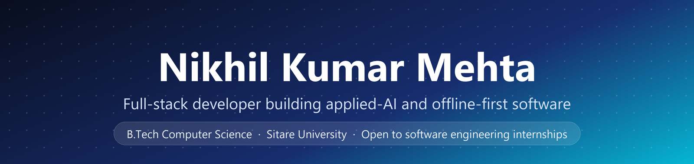
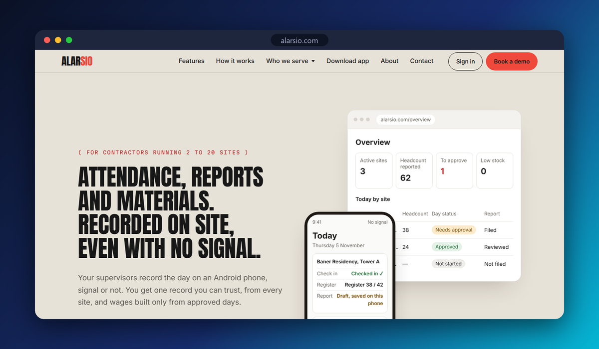
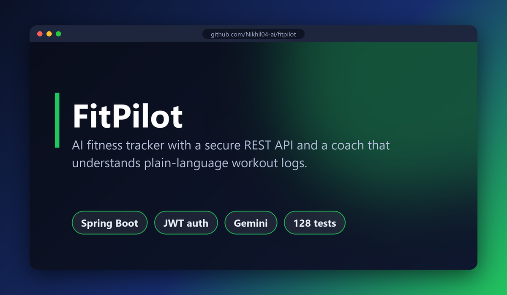
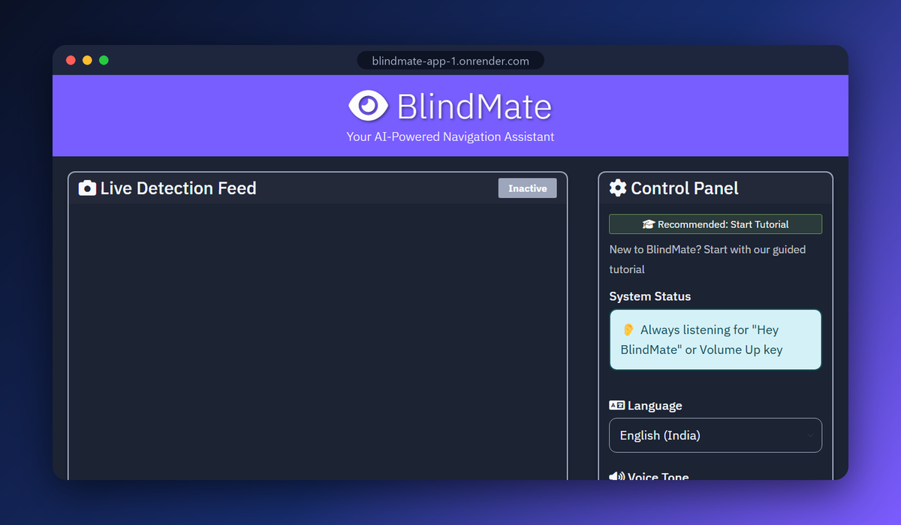
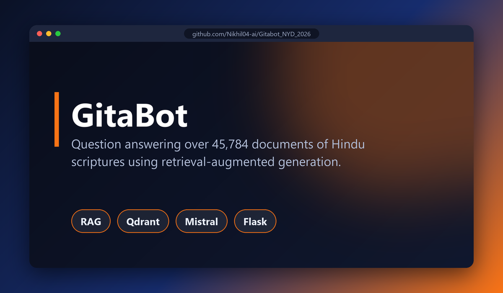
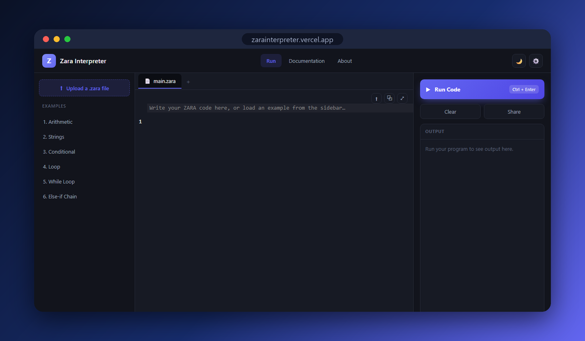
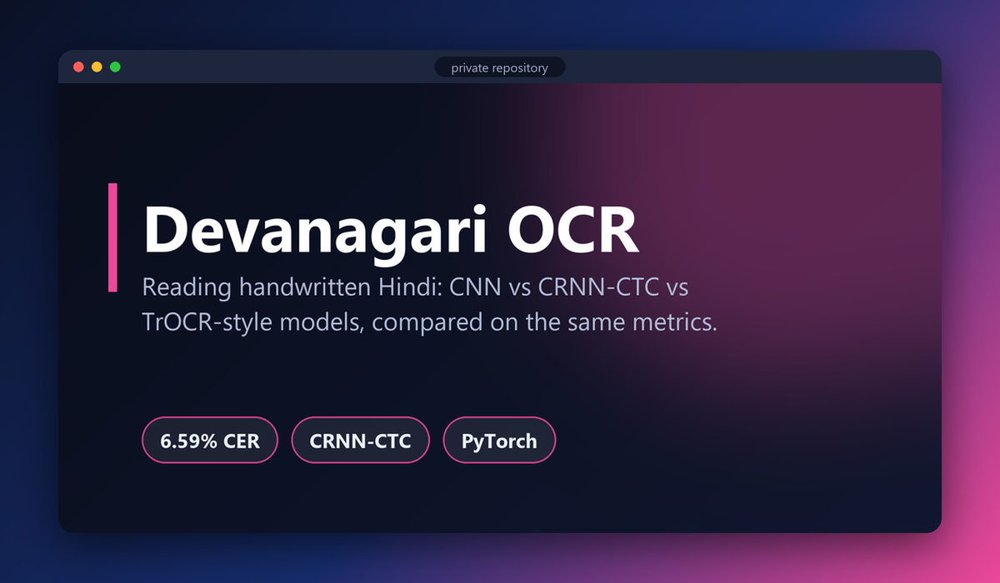

## About

I like taking a problem from idea to a working product, from the database and API to the interface people actually use. Most of my recent work sits in three areas: applied AI (retrieval-augmented generation and LLM apps), software that keeps working without a network, and tools that make technology more accessible.

I study on a full merit scholarship at Sitare University, where I build projects both in teams and on my own.

## Projects

<table>
  <tr>
    <td width="50%" valign="top">
      
       <b><a href="https://github.com/alarsio-labs/alarsio-web">Alarsio</a></b> · <a href="https://www.alarsio.com">Live</a>
       Operations platform for small Indian contractors. Site supervisors record work with no internet and it syncs later. I built the offline sync and materials modules in a team of four.
       TypeScript · Expo · Next.js · Supabase
    </td>
    <td width="50%" valign="top">
      
       <b><a href="https://github.com/Nikhil04-ai/fitpilot">FitPilot</a></b>
       Fitness tracker with a secure REST API and an AI coach that understands plain-language workout logs. Covered by 128 automated tests.
       Java · Spring Boot · MySQL · Gemini
    </td>
  </tr>
  <tr>
    <td width="50%" valign="top">
      
       <b><a href="https://github.com/Nikhil04-ai/Blindmate-app">BlindMate</a></b> · <a href="https://blindmate-app-1.onrender.com/">Live</a>
       Voice-driven assistant for visually impaired users that detects nearby objects in real time and speaks alerts.
       Flask · TensorFlow.js · Gemini
    </td>
    <td width="50%" valign="top">
      
       <b><a href="https://github.com/Nikhil04-ai/Gitabot_NYD_2026">GitaBot</a></b>
       Question answering over 45,784 documents of Hindu scriptures, using semantic search and retrieval-augmented generation.
       Python · Mistral · Qdrant · Flask
    </td>
  </tr>
  <tr>
    <td width="50%" valign="top">
      
       <b><a href="https://github.com/Nikhil04-ai/zara-interpreter">ZARA</a></b> · <a href="https://zarainterpreter.vercel.app">Live</a>
       A small programming language written from scratch in Java (tokenizer, parser, evaluator), with a playground in the browser.
       Java · JavaScript
    </td>
    <td width="50%" valign="top">
      
       <b>Devanagari OCR</b> · private repository
       Compares three models for reading handwritten Hindi. I built the data pipeline and the CRNN-CTC model, which reaches a 6.59% character error rate.
       Python · PyTorch
    </td>
  </tr>
</table>

More work is in my [repositories](https://github.com/Nikhil04-ai?tab=repositories).

## Skills

<table>
  <tr>
    <td><b>Languages</b></td>
    <td></td>
  </tr>
  <tr>
    <td><b>Web &amp; mobile</b></td>
    <td> Also: React Native (Expo)</td>
  </tr>
  <tr>
    <td><b>Data &amp; AI</b></td>
    <td> Also: Qdrant, RAG with Gemini and Mistral</td>
  </tr>
  <tr>
    <td><b>Tooling</b></td>
    <td> Also: Render, pnpm, Turborepo</td>
  </tr>
</table>

## Activity

<picture>
  <source media="(prefers-color-scheme: dark)" srcset="https://github-profile-summary-cards.vercel.app/api/cards/profile-details?username=Nikhil04-ai&theme=tokyonight" />
  
</picture>

## Contributions

<picture>
  <source media="(prefers-color-scheme: dark)" srcset="https://raw.githubusercontent.com/Nikhil04-ai/Nikhil04-ai/output/github-snake-dark.svg" />
  
</picture>

## Get in touch

The best way to reach me is on [LinkedIn](https://www.linkedin.com/in/nikhil-mehta-b3a390325/).
